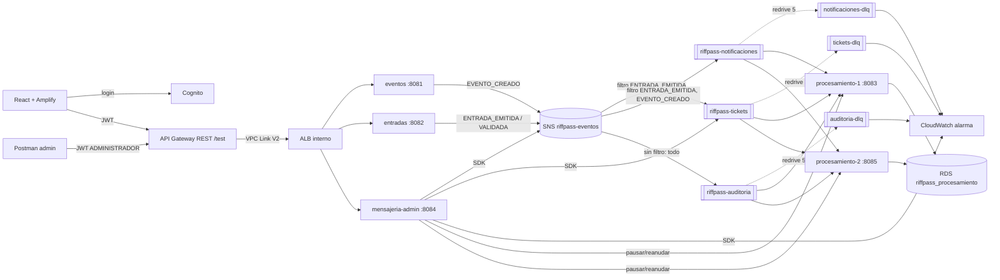
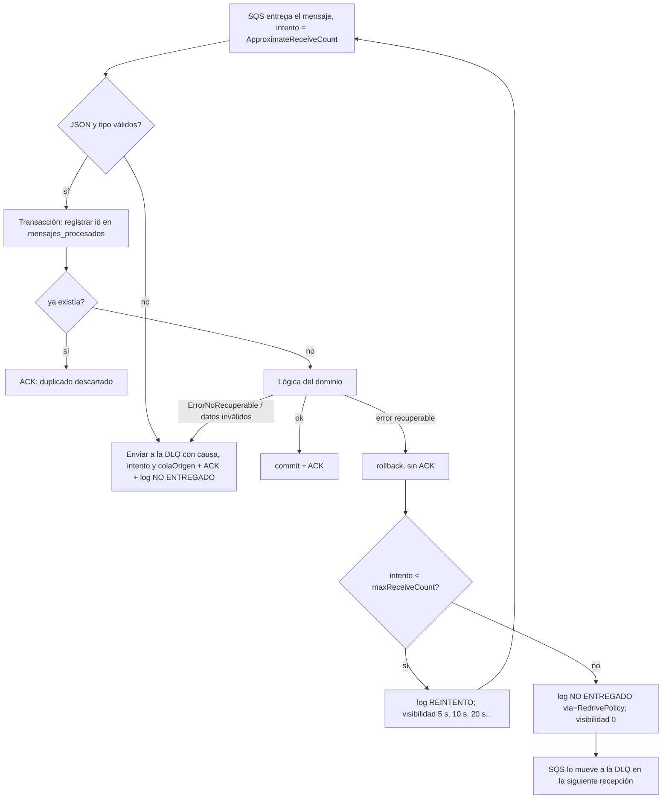

# RiffPass: mensajería asíncrona con SNS y SQS (EP2)

Este documento cubre lo que agrega la Evaluación Parcial 2 sobre el backend de EP1: el diseño, las decisiones con su justificación, la puesta en marcha en AWS y el guion de la demostración. El contrato de negocio de EP1 sigue en [API.md](API.md) y el despliegue base en [AWS_PASO_A_PASO.md](AWS_PASO_A_PASO.md).

## 1. Qué se agregó

| Módulo | Tipo | Responsabilidad |
|---|---|---|
| `riffpass-mensajeria` | Biblioteca | Nombres centralizados (`riffpass-mensajeria.yml` + `MensajeriaProperties`), contrato `EventoMensaje` y productor SNS `PublicadorEventos` |
| `riffpass-eventos-service` | Productor | Publica `EVENTO_CREADO` al crear un concierto |
| `riffpass-entradas-service` | Productor | Publica `ENTRADA_EMITIDA` y `ENTRADA_VALIDADA` |
| `riffpass-procesamiento-service` | Consumidor (2 réplicas) | Consumidores `@SqsListener` por dominio: `tickets`, `notificaciones`, `auditoria` |
| `riffpass-mensajeria-admin-service` | Administrador | API REST de tópicos, colas, suscripciones, consumidores y DLQ; declara la topología al iniciar |

Los servicios de negocio no usan el SDK de AWS: publican un `EventoMensaje` como evento de Spring y `PublicadorEventos` lo envía a SNS **después del commit** (`@TransactionalEventListener`). Así no se anuncia una entrada que finalmente no se guardó.

## 2. Arquitectura



## 3. Rutas de mensajería y patrones de enrutamiento

Un tópico estándar `riffpass-eventos`. Cada publicación lleva el atributo de mensaje `tipo`, que evalúan los filtros (`FilterPolicyScope = MessageAttributes`). Todas las suscripciones usan **Raw Message Delivery**: la cola recibe el JSON original y el atributo `tipo` llega como atributo SQS, sin el sobre de SNS.

| Ruta | Cola / DLQ | Filtro de la suscripción | Consumidor | Funcionalidad |
|---|---|---|---|---|
| TICKETS | `riffpass-tickets` / `riffpass-tickets-dlq` | `{"tipo":["ENTRADA_EMITIDA"]}` | `consumidor-tickets` | Genera el comprobante digital de la entrada |
| NOTIFICACIONES | `riffpass-notificaciones` / `riffpass-notificaciones-dlq` | `{"tipo":["ENTRADA_EMITIDA","EVENTO_CREADO"]}` | `consumidor-notificaciones` | Avisa al titular y anuncia conciertos nuevos (correo simulado en log) |
| AUDITORIA | `riffpass-auditoria` / `riffpass-auditoria-dlq` | sin filtro | `consumidor-auditoria` | Bitácora y estadística de emitidas/validadas por concierto |

| Tipo publicado | Llega a | Patrón |
|---|---|---|
| `ENTRADA_EMITIDA` | tickets, notificaciones y auditoría | **Fanout**: un mensaje, tres trabajos independientes |
| `EVENTO_CREADO` | notificaciones y auditoría | **Entrega selectiva** |
| `ENTRADA_VALIDADA` | solo auditoría | **Entrega selectiva** |

**Cuándo usar cada uno.** Fanout cuando varios procesos independientes reaccionan al mismo hecho y deben poder fallar, escalar o pausarse por separado (generar el ticket no debe esperar al correo). Filtros cuando un consumidor solo necesita algunos tipos: evita recibir mensajes que descartaría, ahorra procesamiento y costo, y el productor no necesita conocer a los consumidores.

**Por qué tres colas.** Cada una tiene una funcionalidad, un ritmo y una criticidad distintos: el ticket es parte del producto, la notificación pierde valor con el tiempo y la auditoría no puede perderse. Separarlas permite parámetros, reintentos, DLQ y alarmas propios, y que un fallo del proveedor de correo no bloquee la generación de tickets.

## 4. Nombres centralizados y topología declarada

- **Única fuente de nombres:** [`riffpass-mensajeria.yml`](../riffpass-mensajeria/src/main/resources/riffpass-mensajeria.yml), importado por los cinco servicios con `spring.config.import`. Lo lee `MensajeriaProperties` y los `@SqsListener` usan placeholders (`${riffpass.mensajeria.colas.tickets.nombre}`). No hay nombres de colas ni tópicos escritos en las clases de negocio.
- **Topología como código:** [`TopologiaMensajeriaConfig`](../riffpass-mensajeria-admin-service/src/main/java/cl/riffpass/admin/config/TopologiaMensajeriaConfig.java) se ejecuta al iniciar el administrador y, de forma idempotente, asegura para cada ruta: tópico, DLQ, cola con Redrive Policy, Redrive Allow Policy de la DLQ, política de la cola que solo acepta mensajes del tópico, suscripción raw con filtro y alarma de CloudWatch.
- **Separación:** configuración en `config/`, infraestructura de mensajería en `mensajeria/`, consumidores en paquetes por dominio (`tickets`, `notificaciones`, `auditoria`) y servicios de negocio sin SDK.

## 5. Parámetros y políticas de retención y limpieza

| Parámetro | tickets | notificaciones | auditoría | Justificación |
|---|---|---|---|---|
| Visibility timeout | 30 s | 30 s | 30 s | El procesamiento tarda menos de 1 s; 30 s cubre picos y evita que otra réplica tome el mensaje mientras se procesa |
| maxReceiveCount | 3 | 5 | 5 | El ticket debe fallar rápido para revisarlo; correo y auditoría toleran más fallos transitorios |
| Retención cola | 4 días | 1 día | 7 días | Ticket: cubre una caída de fin de semana. Notificación: un aviso de más de un día ya no sirve. Auditoría: no debe perderse ni con una caída larga |
| Retención DLQ | 14 días (máx.) | 7 días | 14 días (máx.) | Tiempo para analizar y reprocesar. La DLQ retiene más que su cola, como recomienda AWS: la antigüedad se cuenta desde el envío original |
| Long polling | 20 s | 20 s | 20 s | Menos recepciones vacías y menor costo |
| Raw delivery | sí | sí | sí | El consumidor recibe el contrato JSON tal cual y los atributos quedan disponibles |

**Limpieza:**
- Un mensaje procesado o duplicado se **elimina con ACK**, así que no se acumula.
- Los mensajes que nadie procesa **expiran** al cumplirse la retención; ninguna cola crece sin límite.
- La DLQ se **reprocesa** o se **purga** desde el administrador después de revisar la causa. La alarma avisa en cuanto entra un mensaje, para que no se olvide.
- La tabla `mensajes_procesados` es la memoria de idempotencia. Puede depurarse con seguridad los registros anteriores a la mayor retención (14 días), porque SQS ya no podría reentregar mensajes más antiguos.

## 6. Confirmación y manejo de errores

Toda la política está en [`ManejadorMensajes`](../riffpass-procesamiento-service/src/main/java/cl/riffpass/procesamiento/mensajeria/ManejadorMensajes.java) y la usan los tres consumidores. El contenedor trabaja con `AcknowledgementMode.MANUAL`.



| Caso | Acción | Por qué |
|---|---|---|
| Éxito | ACK explícito | SQS elimina el mensaje solo cuando el trabajo quedó confirmado en la base |
| Duplicado | ACK sin reprocesar | SQS estándar entrega *al menos una vez*. El `id` del evento se inserta con `ON CONFLICT DO NOTHING` en la misma transacción del trabajo; si la otra réplica lo procesa al mismo tiempo, PostgreSQL espera su commit y aquí se descarta |
| Recuperable (timeout, base caída, dependencia) | Sin ACK, backoff con `Visibility` | Reintentar puede funcionar; el backoff evita insistir en una dependencia caída |
| Recuperable en el último intento | Sin ACK y visibilidad 0 | La Redrive Policy lo mueve a la DLQ conservando el mismo `MessageId`, lo que permite relacionar el log con el mensaje almacenado |
| No recuperable (JSON inválido, tipo ajeno a la cola, dato faltante, violación de integridad) | Envío explícito a la DLQ y luego ACK | Reintentar nunca funcionaría; se ahorran recepciones y se conserva la causa como atributo |
| Falla el envío a la DLQ | Sin ACK | No se pierde: se reintenta y, en último caso, la Redrive Policy lo lleva a la DLQ |

**Logs de mensajes no entregados.** Siempre incluyen instancia, cola, `sqsId`, `eventoId`, intento y causa:

```text
REINTENTO instancia=procesamiento-1 cola=riffpass-tickets sqsId=... eventoId=... intento=1/3 causa="ErrorRecuperable: ..." proximoEnSeg=5
NO ENTREGADO instancia=procesamiento-2 cola=riffpass-tickets sqsId=... eventoId=... intento=3/3 causa="..." destino=riffpass-tickets-dlq via=RedrivePolicy
NO ENTREGADO instancia=procesamiento-1 cola=riffpass-tickets sqsId=... eventoId=... intento=1 causa="ErrorNoRecuperable: ..." destino=riffpass-tickets-dlq dlqId=... via=NoRecuperable
```

`GET /api/admin/colas/{cola}/dlq/mensajes` muestra el mismo `sqsId` (o `mensajeOriginalId`) junto con los atributos `causa`, `intento` y `colaOrigen`.

**Fallos simulados (solo demo).** Si `MENSAJERIA_SIMULACION_FALLOS=true`, el campo `simulacion` de un mensaje publicado por el administrador provoca fallos controlados:
- `TRANSITORIO` falla solo el primer intento y luego se procesa.
- `PERMANENTE` falla hasta que el mensaje se reprocesa desde la DLQ, lo que simula que se corrigió la causa.
- `NO_RECUPERABLE` va directo a la DLQ.

Con `@TICKETS`, `@NOTIFICACIONES` o `@AUDITORIA` el fallo afecta solo a esa ruta, y las demás procesan el mensaje normalmente. Los productores de negocio nunca completan ese campo.

## 7. Disponibilidad: dos réplicas del consumidor

`riffpass-procesamiento@1` (8083) y `riffpass-procesamiento@2` (8085) escuchan las mismas tres colas. SQS reparte los mensajes entre quienes hacen polling: un mensaje recibido queda invisible para la otra réplica durante el visibility timeout. Cada log indica `instancia=`, lo que permite ver el reparto.

Si se detiene una réplica, deja de pedir mensajes y termina los que tenía en curso antes de salir (apagado ordenado). Lo pendiente sigue en la cola y lo toma la otra réplica. Si muriera abruptamente, el mensaje sin ACK reaparece al vencer el visibility timeout. **No se pierde porque SQS solo lo borra con ACK.**

## 8. API del administrador

Base: `{{invoke_url}}/api/admin`. Requiere el grupo `ADMINISTRADOR` y el scope `resource-server-riffpass/mensajeria-admin`. La lógica está en `ColaAdminService`; los controladores solo delegan.

| Método y ruta | Acción |
|---|---|
| `GET /topicos` | Listar tópicos |
| `POST /topicos` `{"nombre"}` | Crear tópico |
| `DELETE /topicos/{nombre}[?forzar=true]` | Eliminar tópico (los declarados exigen `forzar`) |
| `POST /topicos/{nombre}/mensajes` `{"tipo","datos","simulacion"?}` | Publicar mensaje de prueba (demostrar fanout y filtros) |
| `GET /topicos/{nombre}/suscripciones` | Suscripciones con filtro y raw delivery |
| `POST /topicos/{nombre}/suscripciones` `{"cola","tipos"}` | Suscribir una cola (raw y filtro opcional) |
| `PUT /topicos/{nombre}/suscripciones/{id}/filtro` `{"tipos"}` | Cambiar filtro |
| `DELETE /topicos/{nombre}/suscripciones/{id}` | Eliminar suscripción |
| `GET /colas` | Estado de todas las colas `riffpass*` |
| `POST /colas` `{"nombre","conDlq","maxRecepciones","visibilidadSeg","retencionSeg","retencionDlqSeg"}` | Crear cola, con su DLQ y Redrive Policy |
| `GET /colas/{nombre}` | Estado: disponibles, en proceso, demorados, antigüedad del más antiguo, DLQ y mensajes en DLQ |
| `DELETE /colas/{nombre}[?forzar=true]` | Eliminar cola |
| `GET /colas/{nombre}/dlq/mensajes?max=10` | Ver la DLQ sin consumirla |
| `POST /colas/{nombre}/dlq/reprocesos?max=10` | Devolver mensajes de la DLQ a su cola (incrementa `reprocesos`) |
| `DELETE /colas/{nombre}/dlq/mensajes` | Purgar la DLQ |
| `GET /consumidores` | Estado de cada consumidor en cada réplica |
| `PUT /consumidores/{id}/estado` `{"estado":"PAUSADO"\|"ACTIVO"}` | Pausar o reanudar en todas las réplicas |

Errores en `application/problem+json`, igual que EP1: 400 validación, 401 sin token, 403 sin rol o scope, 404 recurso inexistente y 409 para recursos protegidos, colas existentes o purga repetida antes de 60 s. La colección Postman incluye la carpeta *EP2 - Mensajería* con 25 solicitudes.

Pausar un consumidor detiene su `MessageListenerContainer`. Los mensajes se acumulan en la cola (`ApproximateNumberOfMessagesVisible` sube) y se procesan al reanudar.

## 9. CloudWatch

| Métrica (AWS/SQS) | Qué indica | Decisión |
|---|---|---|
| `ApproximateNumberOfMessagesVisible` | Pendientes de procesar | Si crece de forma sostenida, faltan consumidores: agregar réplicas o revisar si hay uno pausado |
| `ApproximateNumberOfMessagesNotVisible` | En proceso (recibidos sin ACK) | Si es alto y estable, los consumidores se cuelgan o el visibility timeout es corto |
| `ApproximateAgeOfOldestMessage` | Antigüedad del más antiguo | Mide el retraso real. Si se acerca a la retención, se perderán mensajes |
| `ApproximateNumberOfMessagesVisible` de cada DLQ | Mensajes no entregados | Cualquier valor mayor que 0 exige revisar logs `NO ENTREGADO`, corregir y reprocesar o purgar |

**Alarma** `riffpass-dlq-con-mensajes-<dlq>`: Maximum ≥ 1 durante 1 período de 60 s, con datos faltantes = OK. Notifica al tópico `riffpass-alertas` (correo opcional con `ALARMA_EMAIL`). Se eligió umbral 1 porque, en este sistema, todo mensaje en una DLQ es una entrada sin ticket, un aviso no enviado o un registro de auditoría faltante.

## 10. Puesta en marcha en AWS

Sigue en orden, sobre la infraestructura de EP1 ya desplegada.

1. **Cognito**
   - Agrega al Resource Server el scope `mensajeria-admin`, con la descripción "Administrar mensajería".
   - Habilítalo en el App Client (Login pages).
   - Crea el grupo `ADMINISTRADOR` y agrega tu usuario.
   - En Postman, solicita `openid email profile resource-server-riffpass/mensajeria-admin` y guarda el token en `admin_token`.
2. **Rol de la EC2**
   - Ve a EC2 > Instancia > Actions > Security > Modify IAM role y elige `LabInstanceProfile`.
   - Los servicios obtienen así credenciales temporales de `LabRole` para SNS, SQS y CloudWatch, sin claves en archivos.
3. **Memoria**
   - Ahora corren cinco JVM. Detén la instancia, cambia el tipo a `t3.medium` (4 GB) y vuelve a iniciarla.
   - La IP privada no cambia (el ALB sigue funcionando). La pública sí puede cambiar.
4. **Base del consumidor**
   - Ejecuta en psql `deploy/crear-base-procesamiento.sql` y luego `\password riffpass_procesamiento`.
5. **Compilar y copiar**
   - Ejecuta `mvnw clean verify` y copia los cuatro JAR:
     - `riffpass-eventos-service`
     - `riffpass-entradas-service`
     - `riffpass-procesamiento-service`
     - `riffpass-mensajeria-admin-service`
   - Copia también la carpeta `deploy/`.
   - Ejecuta `sudo bash deploy/install.sh`.
   - Completa `/etc/riffpass/mensajeria-admin.env`, `procesamiento-1.env` y `procesamiento-2.env`. Agrega `AWS_REGION=us-east-1` a los `.env` existentes.
6. **Iniciar en orden**

   ```bash
   sudo systemctl restart riffpass@eventos riffpass@entradas
   sudo systemctl enable --now riffpass@mensajeria-admin
   journalctl -u riffpass@mensajeria-admin -f        # esperar las 3 líneas TOPOLOGIA
   sudo systemctl enable --now riffpass-procesamiento@1 riffpass-procesamiento@2
   ```

7. **ALB**
   - Crea el target group `riffpass-admin-tg`: HTTP 8084 con health `/test/actuator/health`, y registra la EC2.
   - En `riffpass-ec2-sg`, permite 8084 desde `riffpass-alb-sg`.
   - Agrega al listener la regla con prioridad **5**: `/test/api/admin/*` → `riffpass-admin-tg`.
   - Los puertos 8083 y 8085 no se exponen: solo los usa el administrador por `127.0.0.1`.
8. **API Gateway**
   - Renderiza e importa otra vez `deploy/api-gateway.template.json` con *Merge*, o crea a mano el recurso `/api/admin/{proxy+}`:
     - Método ANY.
     - Authorizer `Cognito-riffpass` con el scope `resource-server-riffpass/mensajeria-admin`.
     - Integración HTTP proxy por VPC Link a `http://ALB/test/api/admin/{proxy}`.
     - Mapeo `proxy` ← `method.request.path.proxy`.
   - Haz **Deploy** al stage `test`.
9. **Verificar**
   - Abre SNS > Topics > `riffpass-eventos` y revisa las 3 suscripciones confirmadas, con raw y filtro.
   - Abre SQS y revisa las 6 colas con sus parámetros.
   - Abre CloudWatch > Alarms y revisa las 3 alarmas.

## 11. Guion de la presentación (5 a 10 min)

1. **Integración (1 min).**
   - Inicia sesión en el frontend como asistente y obtén una entrada.
   - En `journalctl -u riffpass@entradas` se ve `PUBLICADO ... tipo=ENTRADA_EMITIDA`.
   - En los consumidores aparecen tres `PROCESADO`, uno por cola. Esto demuestra el fanout con datos reales: el JWT pasó por Gateway.
2. **Consola AWS (1,5 min).**
   - Muestra el tópico, las 3 suscripciones (raw delivery y filtro), las 3 colas y sus DLQ.
   - Explica el visibility timeout, la retención, la Redrive Policy y el maxReceiveCount con la tabla de la sección 5.
3. **Filtros (0,5 min).**
   - Ejecuta Postman E07 (`ENTRADA_VALIDADA`): solo la auditoría registra `PROCESADO`.
4. **Reintento y DLQ (1,5 min).**
   - E08 muestra `REINTENTO` y luego `PROCESADO`.
   - E09 muestra `REINTENTO` 1/3 y 2/3, y luego `NO ENTREGADO ... via=RedrivePolicy`.
   - E10 muestra `NO ENTREGADO ... via=NoRecuperable`.
   - E11 enseña los mensajes en la DLQ, con el mismo id y su causa.
5. **Alarma (1 min).**
   - En CloudWatch la alarma de `riffpass-tickets-dlq` pasa a *In alarm*.
   - Muestra las cuatro métricas y la decisión asociada a cada una.
6. **Administrador (1,5 min).**
   - E12 reprocesa la DLQ: el mensaje `PERMANENTE` ahora se procesa y la alarma vuelve a OK.
   - E15 pausa el consumidor de tickets. Con E06 sube el valor de "disponibles" en E03. E16 lo reanuda y la cola se vacía.
   - E17 a E24 crean y eliminan una cola, un tópico y una suscripción, y el efecto se ve en la consola.
7. **Dos réplicas (1 min).**
   - Ejecuta E06 varias veces: los logs alternan `instancia=procesamiento-1/2`.
   - Ejecuta `sudo systemctl stop riffpass-procesamiento@1`, publica más mensajes y verifica que `procesamiento-2` los procesa todos y que las colas quedan en 0. Explica por qué no se pierden.
8. **Cierre.** Explica la retención, la limpieza y la purga (E13) con la sección 5.

## 12. Ejecutar localmente

Se requieren credenciales del Learner Lab en la sesión de terminal (`aws configure` o variables `AWS_*` temporales, nunca en archivos del proyecto). Con el perfil `local` cada servicio usa H2:

```bash
java -jar riffpass-mensajeria-admin-service/target/riffpass-mensajeria-admin-service-1.0.0.jar
java -jar riffpass-procesamiento-service/target/riffpass-procesamiento-service-1.0.0.jar --spring.profiles.active=local
```

Para dos réplicas locales, usa `PORT=8085 INSTANCIA=procesamiento-2` en otra terminal. **No se pueden compartir dos réplicas sobre el mismo archivo H2.** Para probar la idempotencia entre réplicas, usa PostgreSQL.

## Estado de verificación

- **Verificado localmente:** los módulos compilan y las pruebas pasan (`mvnw test`). Esto incluye el ACK, el duplicado, el reintento con rollback, el último intento hacia la redrive, el envío no recuperable a la DLQ, la simulación por ruta, la Redrive Policy y el filtro generados por el administrador, la protección de recursos declarados y la seguridad del administrador.
- **Verificado en AWS (19/10/2026, us-east-1):**
  - **Topología:** el administrador creó el tópico, 3 colas, 3 DLQ, 3 suscripciones *Confirmed* con raw delivery y filtro, y 3 alarmas. Las 6 colas son Standard y están cifradas con SSE-SQS.
  - **Integración:** crear un concierto desde el frontend llegó a notificaciones y auditoría. Obtener una entrada llegó a tickets, notificaciones y auditoría con el mismo `eventoId` (fanout). Validar llegó solo a auditoría.
  - **Dos réplicas:** los mensajes se repartieron entre `procesamiento-1` y `procesamiento-2`. Con `procesamiento@1` detenido, la réplica 2 procesó los 4 conciertos siguientes sin pérdidas. Tras reiniciar el laboratorio, los 5 servicios arrancaron solos.
  - **Errores:** un mensaje `PERMANENTE@TICKETS` publicado desde SNS registró `REINTENTO` 1/3 (5 s) y 2/3 (10 s), y luego `NO ENTREGADO` 3/3 `via=RedrivePolicy`, con id, intento y causa. Notificaciones y auditoría lo procesaron normalmente. Quedó 1 mensaje en `riffpass-tickets-dlq` y la alarma pasó a *In alarm* en unos 2,5 min.
  - **Administrador:** se probaron E14–E24 (consumidores, pausar y reanudar, crear y eliminar cola, tópico y suscripción, cambiar filtro). E11 mostró el mensaje con el mismo `sqsId`. E12 lo reprocesó: `PROCESADO` en tickets con el mismo `eventoId` y la alarma volvió a *OK*. E13 purgó la DLQ y respondió 409 al repetirlo antes de 60 s.
  - **Sin evidencia registrada:** el caso `NO_RECUPERABLE` en AWS (sí cubierto por las pruebas automáticas) y la notificación por correo de la alarma (el tópico `riffpass-alertas` no tiene suscriptores).
